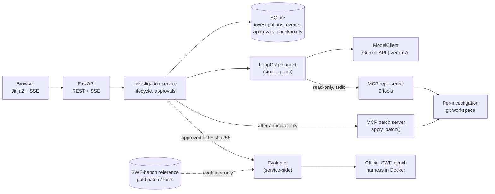
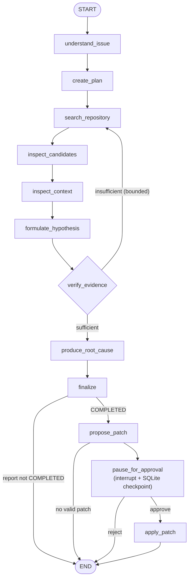
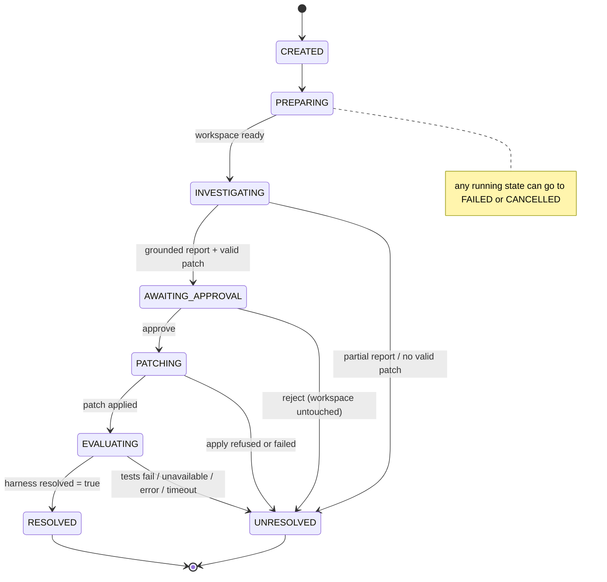

# BugTrace

**An AI incident investigator that shows its work.** Give BugTrace a real bug report from
[SWE-bench Verified](https://www.swebench.com/) and it checks out the repository at the
commit before the human fix. It searches the code with read-only tools, ranks suspect
files and functions, and writes a root-cause report in which every claim cites evidence
it actually collected. It may then propose a patch, but it changes nothing until a human
approves that exact diff. An approved patch can be graded by the official SWE-bench
harness, which the agent can never see.

> **In one line:** a single LangGraph agent with MCP repository tools, evidence-grounded
> root-cause analysis, a human approval gate before any mutation, and a hard wall between
> what the agent sees and the benchmark answers.

<!-- SCREENSHOT PLACEHOLDER: investigation page (timeline, suspects, evidence, diff, approval).
     Not yet captured. Add docs/assets/investigation.png and link it here. -->
*Screenshot / demo GIF: placeholder, not captured yet.*

---

## Why it exists

Coding agents usually return a diff and nothing else. A reviewer cannot tell what the agent
looked at, why it chose that file, or whether the fix works. Agent benchmarks also make it
easy to leak the answer, for example by putting the gold patch or test names in the
prompt. BugTrace is built around three rules:

1. **Investigate before patching.** Collect evidence first, then propose a fix.
2. **No claim without evidence.** Each root-cause claim cites evidence IDs returned by
   tools. Claims with no real evidence ID are dropped, and suspects on paths no tool
   returned are rejected.
3. **No mutation without approval.** Read and write are separate servers. The write path
   applies only the approved diff, identified by its sha256.

## Project status

| | What | Status |
|---|---|---|
| ✅ **Implemented and tested** | Safe SWE-bench case adapter, isolated git workspaces, read-only MCP server (9 tools), LangGraph agent, grounding checks, patch validation, approval gate, privileged patch server, evaluator boundary, SQLite persistence and checkpoints, FastAPI, SSE UI, CI, deterministic regression suite, Gemini and Vertex backends, Dockerfile, Cloud Run service template | 341 tests pass and 2 opt-in tests are skipped; CI covers lint and tests |
| 🧪 **Validated locally against real data** | 10 real cases seeded. Real repository checkout at `base_commit`. A live Gemini run on `astropy__astropy-12907` reached a COMPLETED report with MEDIUM confidence (11 tool calls, 5 grounded claims). The real SWE-bench reference row was fetched and its base commit verified. The production entrypoint ran from a copy of the image contents | Single runs, not benchmarks |
| ⚠️ **Limited by the environment** | Live runs often hit Gemini 429/503 errors, and those runs degrade to PARTIAL/LOW with no patch, as designed. **No end-to-end live patch proposal has been produced.** Docker is not installed, so **no real SWE-bench harness verdict has been produced** and the container image has not been built | Code paths are tested with a stub model and a fake harness |
| ☁️ **Not deployed** | Cloud Run and Vertex AI: config, docs and tests exist. **Nothing has been deployed to GCP, and no live Vertex AI call has been made.** GitHub Actions workflows are written and checked with actionlint, but have not run on GitHub | Deployment path only |

**No benchmark numbers are claimed.** The only metrics in this repo come from the
deterministic stub-model regression suite (`evals/baselines/stub.json`). They test the
pipeline mechanics. They do not measure model quality.

---

## Architecture



The dotted edge is the leakage boundary. Gold data reaches only the evaluator. The agent,
both MCP servers, the workspace and data packages, prompts, checkpoints, API responses
and pages never import or contain it, and tests enforce this.

### LangGraph orchestration

One explicit graph (`app/agent/graph.py`), not a multi-agent swarm. Loops are bounded:
4 iterations, 30 tool calls and 2 patch attempts by default. When a limit is reached, the
agent returns a PARTIAL/LOW report instead of guessing.



### Investigation lifecycle (status machine)

Enforced by the store (`app/storage/models.py`). Any other transition is rejected.



### MCP repository tools

The LLM gets **no shell**. The read-only stdio server (`app/mcp_servers/repo_server.py`)
exposes `list_directory`, `read_file` (max 300 lines), `search_code`, `find_symbol`,
`list_test_files`, `git_log`, `git_show`, `git_diff` and `check_patch`
(`git apply --check`). Each tool returns typed results and a deterministic evidence ID
(`ev-<hash>`). Paths are resolved inside the investigation workspace. Traversal, symlink
escapes, `.git` and `.env` are rejected, and so are git refs or globs that could be read
as options.

A **separate** patch server exposes a single tool, `apply_patch()`, which takes no
arguments. It applies the stored patch only if the investigation is PATCHING, an
`approve` decision is recorded, and the patch sha256 matches the approved one. It never
commits or pushes.

### Evidence-grounded root cause

- Evidence records are typed (`issue`, `code`, `git`, `test`) and the agent cites them by ID.
- **Sufficiency:** a root cause needs at least 2 evidence records, at least 1 of them
  code. HIGH confidence also needs test or git evidence. Confidence is LOW, MEDIUM or
  HIGH, never a made-up decimal.
- Suspects are ranked by explicit scoring logic, not by the model's self-reported
  confidence.
- Model output is checked against what the tools actually returned. Unknown evidence IDs
  are stripped from claims, and a claim left with no known ID is dropped. Suspects on
  paths that no tool returned are rejected. If a model call fails, the report is forced
  down to PARTIAL/LOW.

### Safe patch validation

Model diffs pass through these checks before a human sees them:
1. A strict unified-diff parser. It allows edits to existing files only: no
   create/delete/rename/mode/binary changes, no `..`, absolute, `.git` or `.env` paths,
   standard 3-line context, and correct hunk counts.
2. A grounding check: every touched file must appear in collected evidence.
3. A read-only `git apply --check` run in the workspace.

An invalid diff is retried with validator feedback, at most `agent_max_patch_attempts`
times, and then the case ends UNRESOLVED.

### SWE-bench evaluation boundary

- `PublicCase` (agent-safe) and gold models live in separate modules. Only
  `app/evaluation` may import gold data, and import-graph tests enforce this.
  `hints_text` is excluded as well.
- Evaluation is **not** an agent tool or graph node. After an approved patch is applied,
  the service builds an `EvaluationRequest`, which re-checks the approval, the sha256
  binding and the workspace (no unexpected changes). It then runs the pinned official harness
  (`swebench==5.0.2`) in an isolated `uv` environment with a timeout and a dedicated
  process group.
- RESOLVED comes **only** from the harness's own `resolved: true`. API and UI results
  store test *counts*, never test names. Harness logs and reference rows stay in
  `var/evaluations/`, which is never served.

### Deterministic regression testing and CI

- `make regression` runs 10 end-to-end scenarios with a stub model, a tiny fixture
  repository and a fake harness subprocess: resolved, tests fail, evaluator unavailable,
  timeout, crash, apply failure, rejected, invalid patch and partial report. Each goes
  through the real API, service, store, graph and patch server, and checks:
  - the exact status path
  - zero unauthorized writes
  - sha256 binding from proposal to evaluation
  - no gold text anywhere: API, pages, SSE, checkpoint bytes
  - identical state after a restart

  The summary is compared against a committed baseline.
- `.github/workflows/ci.yml` runs on push and pull requests with no secrets, Gemini,
  Docker or network.
- `.github/workflows/agent-eval.yml` is manual only (`workflow_dispatch`). It runs live
  agent evaluation on 3 seeded cases plus the real SWE-bench integration check.

---

## Setup

Requirements: [uv](https://docs.astral.sh/uv/) and Git. uv installs Python 3.12. Docker
is optional and only needed for real SWE-bench grading.

```bash
git clone <this-repo> bugtrace && cd bugtrace
make setup                 # uv sync (locked dependencies)
cp .env.example .env       # never committed; see "Configure Gemini" below
make doctor                # environment checks (Docker shows as a WARNING if absent)
make test                  # full suite, no network or API key needed
```

### Configure Gemini (local default)

Set these in `.env`:

```bash
BUGTRACE_MODEL_BACKEND=gemini
BUGTRACE_MODEL_NAME=<a Gemini model ID your key can use>
GEMINI_API_KEY=<your key>
```

No model ID is hard-coded anywhere in `app/`.

### Seed cases

`data/cases.jsonl` already contains 10 agent-safe SWE-bench Verified cases. To regenerate
it (needs network):

```bash
make seed                                          # default 10 cases
uv run python scripts/seed_cases.py --limit 20     # more cases
```

### Run an investigation

```bash
make dev        # UI at http://127.0.0.1:8000; pick a bug and click "Investigate this bug"
```

Or run one from the CLI. The record is exported to `var/investigations/<id>.json`:

```bash
make investigate CASE=astropy__astropy-12907
```

In the UI, a COMPLETED investigation with a valid patch stops at **Waiting for your
approval** (status AWAITING_APPROVAL). It shows a plain summary of the suggested fix, and
the raw diff is under "View code changes". **Approve fix** applies it in that
investigation's workspace only. **Reject fix** leaves the workspace byte-identical.

The UI explains everything in plain language first: the bug, what BugTrace found, the
likely causes, the evidence and the suggested fix. Technical details such as evidence
IDs, file paths, commit hashes, tool-call counts and the raw diff sit in a secondary
style or behind "Technical details" disclosures. Bug titles and summaries for the seeded
cases are hand-written display copy (`app/web/case_guides.json`), based only on the
public bug reports. Other cases fall back to the report's own first line.

### Tests, lint and regression

```bash
make format       # ruff format + autofix
make lint         # ruff check + format check
make test         # unit, fixture-repo integration and regression tests
make regression   # regression scenarios only; writes var/evals/regression.json
```

### Optional: real SWE-bench integration (network; harness test needs Docker)

```bash
make eval-integration                      # SWEBENCH_INTEGRATION=1, real reference row + harness
make agent-eval                            # live agent on evals/cases.json (needs GEMINI_API_KEY)
make agent-eval ARGS=--approve-patches     # also approve and grade proposals (needs Docker)
```

On Apple Silicon, the SWE-bench images are x86_64 and run under emulation, which is slow.

### Configure Vertex AI and Cloud Run

Vertex AI locally, using Application Default Credentials (no key file):

```bash
gcloud auth application-default login
BUGTRACE_MODEL_BACKEND=vertex BUGTRACE_MODEL_NAME=<vertex-model-id> \
  GOOGLE_CLOUD_PROJECT=<project-id> GOOGLE_CLOUD_LOCATION=<vertex-location> make dev
```

Cloud Run: build with Cloud Build, render the service with `make cloud-run-config`, then
deploy with `gcloud run services replace`. The service is IAM-protected (never
`allUsers`), runs as a single instance with evaluation disabled, and the runtime service
account has only `roles/aiplatform.user`. See
**[docs/DEPLOYMENT.md](docs/DEPLOYMENT.md)** for the full command sequence, IAM roles and
storage caveats.

---

## Security model (summary)

| Concern | Control |
|---|---|
| Secrets | `.env` and credential files are git-ignored and excluded from the Docker and Cloud Build contexts (tested). The key is never rendered by `Settings` or `/api/ready`. Cloud Run uses a service account, not keys. |
| Gold-data leakage | Separate models, import-graph tests, and recursive no-gold-key checks on the API, pages, SSE, checkpoints and records |
| Arbitrary execution | No shell tool. No `shell=True`. Every subprocess uses an argument list, an explicit cwd, a timeout and a scrubbed `GIT_*` environment |
| Workspace isolation | One clone per investigation under `var/workspaces/<uuid>/repo`. Path resolution rejects traversal and symlink escapes, and git never walks up into the BugTrace repo |
| Mutation | Only the patch server can write, only after a recorded approval bound to the diff's sha256. No commit, push, merge or remote PR |
| Untrusted text | Issue text and model output are HTML-escaped in templates |

There is no authentication on the local UI or API. It is a single-user local tool, and
the Cloud Run deployment relies on Cloud Run IAM.

## Known limitations

- **No real harness verdict yet** (needs Docker). **No live patch proposal yet**: live
  runs so far were limited by Gemini quota and overload. Those runs ended PARTIAL/LOW and
  correctly proposed no patch.
- The default seed is the first 10 rows of the split, all `astropy/astropy`.
- `find_symbol` is a Python text heuristic. Search uses `git grep`. Workspaces are shallow,
  so git history evidence covers only the base commit.
- Runs are in-process asyncio tasks with no queue. A run in flight at shutdown is marked
  FAILED and not resumed. A case waiting for approval does survive restarts, via the
  LangGraph checkpoint.
- On Cloud Run, SQLite lives in the instance's in-memory filesystem and is lost on
  scale-to-zero or redeploy. Durable storage (Cloud SQL plus a Postgres checkpointer)
  is not implemented.
- After a failed evaluation, the case ends UNRESOLVED. No automatic reopen-and-revise
  loop exists.
- Model call counts and token usage are not recorded yet (left null, not estimated).
- Optional V3 extensions (incident memory, n8n trigger, multimodal) are not implemented.

## Repository map

```text
app/agent/         LangGraph graph, state, prompts, model client, diff validator
app/mcp_servers/   read-only repo server, privileged patch server, client
app/workspace/     per-investigation git workspaces, safe subprocess runner
app/data/          SWE-bench adapter and agent-safe PublicCase
app/evaluation/    gold data, harness runner, metrics, reports (evaluator only)
app/services/      investigation lifecycle, approvals, evaluation hand-off
app/storage/       SQLite store and status machine
app/api/, app/web/ REST endpoints, pages, SSE stream
tests/             341 tests: security, leakage, regression scenarios, CI and cloud config
docs/              design docs (architecture, agent, MCP, data, API, evaluation, deployment)
                   and PORTFOLIO.md (summary + CV bullets)
tasks/, PROGRESS.md  the spec-driven task log the project was built from
```

Build history, test evidence and every validated or unvalidated claim are recorded in
[PROGRESS.md](PROGRESS.md).
