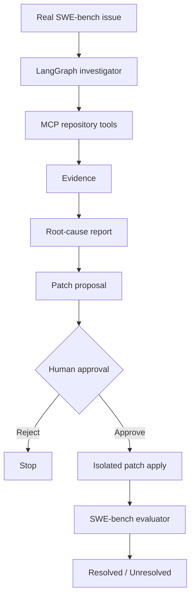

# BugTrace
<p>
  
  
  
  
  
</p>

<p>
  
  
  
  
  
  
</p>
**Evidence-grounded investigation of real software bugs.**

BugTrace starts from a real, historical software issue and inspects the affected repository
as it was before the fix. It collects evidence, explains the likely root cause and can
propose a fix. Nothing changes without human approval, and fixes are graded independently
with SWE-bench.

BugTrace is a benchmark and AI systems engineering project. It is not an autonomous
production bug fixer.

Python · FastAPI · LangGraph · MCP · Pydantic · Gemini / Vertex AI · SWE-bench · pytest

<br>

## Demo

<!--
  Demo assets are not captured yet. When they exist, add:
    docs/assets/bugtrace-demo.gif   homepage → choose bug → timeline → evidence → root cause
    docs/assets/home.png
    docs/assets/investigation.png
  and replace this comment with:
    
-->

*Screenshots and demo GIF coming soon.*

<br>

## Why BugTrace?

A typical coding-agent workflow is opaque:

```text
issue → LLM → code
```

BugTrace shows each step and keeps a person in control:

```text
real bug report
  → repository investigation
  → evidence collection
  → grounded root-cause analysis
  → proposed patch
  → human approval
  → isolated patch application
  → benchmark evaluation
```

<br>

## What it does

### Investigates real software issues

Cases come from [SWE-bench Verified](https://www.swebench.com/): real GitHub issues from
real open-source projects, each paired with the code as it was before the original fix.

The agent receives the issue text, the repository and the base commit. It never receives
the original developer's solution.

### Collects evidence

The agent has no shell. It works through read-only [MCP](https://modelcontextprotocol.io/)
tools: code search, file reads, symbol lookup, related tests, git history and diffs.

Tool results become evidence records, each with a stable, deterministic ID.

### Grounds conclusions

- Root-cause claims must cite collected evidence IDs.
- Claims without valid evidence are dropped.
- Weak evidence produces a partial, low-confidence report instead of invented certainty.

### Requires human approval

- Proposed patches are validated before anyone sees them.
- No patch is applied automatically.
- Approval is bound to the exact diff by its SHA-256 hash.
- Nothing is committed or pushed to GitHub.

### Evaluates independently

- Approved patches can be graded with the official SWE-bench harness.
- The agent never sees the hidden reference answer.
- The evaluator, not the agent, decides RESOLVED or UNRESOLVED.

<br>

## Architecture



| Document | Covers |
|---|---|
| [docs/ARCHITECTURE.md](docs/ARCHITECTURE.md) | Components and status lifecycle |
| [docs/AGENT.md](docs/AGENT.md) | LangGraph graph, evidence rules, loop limits |
| [docs/MCP.md](docs/MCP.md) | Repository tools and their safety rules |
| [docs/API.md](docs/API.md) | REST endpoints, event stream, UI |
| [docs/DEPLOYMENT.md](docs/DEPLOYMENT.md) | Vertex AI and Cloud Run deployment path |

<br>

## Quick start

### Requirements

**Required**

- Python 3.12 (uv installs it if needed)
- Git
- [uv](https://docs.astral.sh/uv/)
- A Gemini API key, for live investigations

**Optional**

- Docker Desktop, for real SWE-bench evaluation
- GCP credentials, for the Vertex AI / Cloud Run path

### Install

```bash
git clone <repo-url>
cd bugtrace
uv sync
cp .env.example .env
```

Set the minimum values in `.env`:

```bash
BUGTRACE_MODEL_BACKEND=gemini
BUGTRACE_MODEL_NAME=<model>
GEMINI_API_KEY=<your-key>
```

`.env` is git-ignored. Never commit a real key.

### Run

```bash
make seed   # optional: 10 cases are already included in data/cases.jsonl
make dev
```

Open [http://127.0.0.1:8000](http://127.0.0.1:8000), choose a bug and click
**Investigate this bug**.

<br>

## Development

```bash
make test               # full test suite
make lint               # ruff check + format check
make regression         # deterministic end-to-end scenarios
make eval-integration   # opt-in real SWE-bench check
```

- Normal tests use a stub model and need no Gemini key or network.
- Regression scenarios use a fake harness and need no Docker.
- `make eval-integration` is opt-in. It needs network access, and Docker for the harness run.

<br>

## Benchmark design

Generation and evaluation are kept apart.

| Agent side | Evaluator side |
|---|---|
| Issue text | Gold patch |
| Repository | Hidden test metadata |
| Buggy (base) commit | Official SWE-bench harness |
| Collected evidence | |

Gold data is never fed back into the agent. The two sides use separate models and
modules, and tests check that gold data never appears in prompts, checkpoints, API
responses or pages.

<br>

## Safety boundaries

- Repository investigation is read-only.
- Each investigation gets its own isolated workspace.
- Path traversal, symlink escapes, `.git` and `.env` access are rejected.
- Patch proposals must be grounded in collected evidence.
- Diffs must have standard context and pass `git apply --check`.
- A human approves before any mutation.
- The applied patch must match the approved patch's hash.
- Nothing is committed or pushed automatically.
- Gold data stays on the evaluator side.

<br>

## Current status

| Capability | Status |
|---|---|
| Repository investigation | Implemented and locally tested |
| Evidence-grounded diagnosis | Implemented and locally tested |
| Human-approved patching | Implemented and tested |
| Deterministic regression suite | Implemented |
| GitHub Actions CI | Implemented |
| SWE-bench evaluator integration | Implemented |
| Real Docker-backed benchmark run | Not yet validated (Docker not available in the dev environment) |
| Gemini live investigation | Supported, subject to API quota |
| Vertex AI backend | Implemented, not deployed |
| Cloud Run deployment path | Implemented, not deployed |

No benchmark success rate is claimed. Results will be published only after real harness
runs.

<br>

## What this project is, and isn't

BugTrace explores trustworthy AI-assisted software engineering:

- gather evidence before making claims
- expose every investigation artifact
- fail safely when evidence is weak
- keep generation separate from evaluation
- require human approval before code mutation
- benchmark against real software issues

It is not intended to repair live production repositories autonomously.

<br>

## Tech

Python · FastAPI · LangGraph · MCP · Pydantic · Gemini / Vertex AI · SQLite · Jinja · JavaScript · SWE-bench · pytest · GitHub Actions

<br>

## License

MIT
