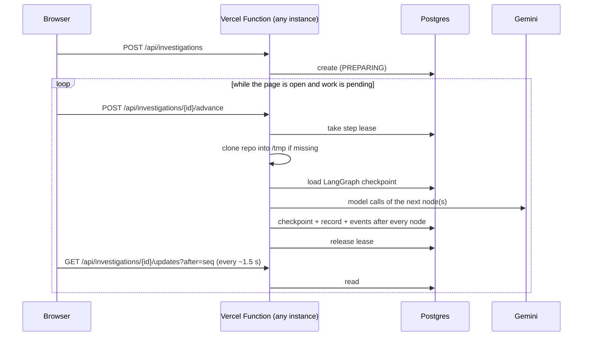

# Deployment

BugTrace runs in three ways, all from the same code. The agent, graph, MCP tools,
prompts, grounding rules and approval gate are identical in each; only configuration
differs.

| | Local development | Vercel (serverless public demo) | Cloud Run (production-style) |
|---|---|---|---|
| Start | `make dev` (uvicorn `--reload`, 127.0.0.1:8000) | Vercel Python runtime serves `app.main:app` | container `CMD python -m app.serve` (0.0.0.0:`$PORT`) |
| Model | `gemini` + `GEMINI_API_KEY` (or `vertex`) | `gemini` + `GEMINI_API_KEY` | `vertex` + service-account ADC |
| Execution | background asyncio task per run | **stepwise**: bounded `advance` requests | background asyncio task per run |
| Storage | SQLite in `var/` | **Postgres** (`DATABASE_URL`), store + LangGraph checkpoints | SQLite in `/tmp` (ephemeral) |
| Live UI | SSE | polling (~1.5 s) | SSE |
| SWE-bench evaluation | enabled (needs Docker) | disabled | disabled |
| Logs | text | text (Vercel function logs) | JSON lines (`severity`, `message`, `logger`, `time`, `stack_trace`) |

## Capability matrix

| Capability | Local | Vercel | Cloud Run |
|---|---|---|---|
| FastAPI + Jinja UI | Yes | Yes (same app, static files from the CDN) | Yes |
| Gemini API (key) | Yes | Yes (the supported backend) | Possible; `vertex` is the configured default |
| Vertex AI | Yes (ADC via `gcloud`) | Not configured (no ADC on Vercel) | Yes |
| SQLite | Yes (default) | No (rejected by configuration) | Yes (default, in-memory `/tmp`) |
| Postgres | Optional (`BUGTRACE_STORAGE_BACKEND=postgres`) | Required (`DATABASE_URL`) | Optional, not validated |
| Durable investigation state | Yes (`var/` on disk) | Yes (Postgres: investigations, events, approvals, step leases, LangGraph checkpoints) | No with SQLite (lost with the instance) |
| Repository workspace | Persistent per investigation (`var/workspaces`) | Temporary, in the instance's `/tmp`; re-cloned by any step that runs on an instance without it | Temporary, per instance |
| Human approval | Yes | Yes (sha256-bound, recorded in Postgres) | Yes |
| Patch application | Yes (isolated workspace) | Yes (temporary workspace; the applied diff is recorded in the database) | Yes (isolated workspace) |
| SWE-bench Docker evaluation | Yes (needs Docker) | No: "Full SWE-bench evaluation requires the local/manual evaluation environment." | No |
| SSE (`/events`) | Yes (UI default) | Endpoint exists; the UI does not use it | Yes (UI default) |
| Polling (`/updates`) | Yes with `BUGTRACE_EXECUTION_MODE=stepwise` | Yes (UI default) | Not used |
| Deployment status | Runs locally | Configuration added and simulated locally; **not deployed** | Configuration added; **not deployed** |

## Vercel (serverless public demo)

A Vercel Function may be frozen or destroyed as soon as it responds, runs for at most
300 s on Hobby, and has only a small, per-instance writable `/tmp`. The local design
(an asyncio task that runs a whole investigation for several minutes, SQLite on disk,
a long-lived SSE connection) does not survive that. The Vercel mode changes how work is
scheduled and where state lives. It does not change what the agent does.

### Architecture



- **Stepwise execution** (`BUGTRACE_EXECUTION_MODE=stepwise`). `POST /api/investigations`
  only creates the run. Nothing runs after any response. Each `POST
  /api/investigations/{id}/advance` takes a lease, runs the same compiled LangGraph
  graph from its latest checkpoint, starts nodes only until `BUGTRACE_STEP_BUDGET_SECONDS`
  (default 40 s) have passed, persists, and returns. Checkpoints are written
  synchronously (`durability="sync"`) after every node, so the next request, on any
  instance, continues at the next node. The graph is not replaced or reimplemented:
  it is the same graph with the same interrupt for approval.
- **Bounded requests.** On Vercel, a model call is capped at 45 s with 2 attempts. A
  step is cancelled after `BUGTRACE_STEP_TIMEOUT_SECONDS` (240 s), before Vercel's
  300 s `maxDuration` (pinned in `vercel.json`); a cancelled node re-runs from the last
  checkpoint on the next step.
- **Leases and bounded retries.** A lease (`investigation_steps` table) stops two tabs
  or two instances from driving one run at once: a second caller gets `"busy"`. The
  lease outlives the platform limit (`BUGTRACE_STEP_LEASE_SECONDS`, 310 s), so a step
  killed by the platform is taken over only after it is certainly dead. A failed,
  timed-out or abandoned step adds a `STEP RETRY` event; after
  `BUGTRACE_STEP_MAX_FAILURES` (3) consecutive failures the run is FAILED.
- **The browser drives progress.** The investigation page polls `/updates` and keeps one
  `advance` in flight while the server reports pending work. If every tab is closed,
  the run simply waits in its current status; opening the page continues it. There is
  no background worker, cron job or queue.
- **Cold starts don't fail runs.** In stepwise mode the startup `recover()` does nothing:
  an in-flight status means "continue", not "the process died".
- **Approval.** `decision` records the human decision (hash-bound, as locally) and
  starts nothing; the next `advance` resumes the paused graph. An approve step
  re-clones the workspace if needed, applies exactly the approved patch through the
  privileged patch MCP server (which re-checks the approval in Postgres), records the
  diff, and ends the case UNRESOLVED / NOT EVALUATED.

### Persistence

`BUGTRACE_STORAGE_BACKEND=postgres` (forced on Vercel) selects
`PostgresInvestigationStore` (`app/storage/postgres.py`) and LangGraph's
`AsyncPostgresSaver`. The store uses the same schema and SQL as SQLite, a short-lived
connection per call, and `SELECT ... FOR UPDATE` row locks on writes. Prepared
statements are disabled, so pooled (transaction-mode) connection strings work, but a
direct connection string is the conservative choice. The patch server subprocess gets
the URL through its environment, never its command line. Tables are created on first
use. Vercel mode refuses to start without `DATABASE_URL`: it never falls back to
SQLite.

Durable in Postgres: investigations, the event timeline, approvals, evaluation results,
step leases and LangGraph checkpoints. Not durable: repository workspaces (re-cloned
into `/tmp` when a step runs on an instance that doesn't have one; a shallow clone of
the seeded astropy cases took about 5 s locally).

Any Postgres provider works; nothing is vendor-specific. Free tiers that fit:
**Neon** (installable from the Vercel Marketplace, which injects `DATABASE_URL`) and
**Supabase** (copy its connection string into `DATABASE_URL`). Free tiers have storage,
compute and connection quotas, and may suspend idle databases (the first request after
a pause is slower). Check the provider's current limits; they are not unlimited.

### Workspaces and the git binary

Only the seeded SWE-bench cases (`data/cases.jsonl`, bundled with the function) can be
investigated; there is no arbitrary-repository mode in any deployment. The repository
tools and workspace manager run the `git` binary. **Vercel does not document `git` as
part of the Python function runtime.** `GET /api/ready` reports a `git` check. If it
says "git binary not found", investigations on that deployment will fail after their
bounded retries. This is the main risk to check on the first deploy (see "Validation
status").

### SWE-bench evaluation

Disabled on Vercel and not configurable there (`BUGTRACE_EVALUATION_ENABLED=true` is a
configuration error). The service uses `DisabledEvaluator`; the SWE-bench evaluator,
the harness and gold-data modules are never imported (`app/evaluation/boundary.py`
loads them lazily, only when evaluation is enabled). The UI says: "Full SWE-bench
evaluation requires the local/manual evaluation environment."

### Environment variables

| Variable | Local SQLite | Vercel | Cloud Run / Vertex |
|---|---|---|---|
| `BUGTRACE_MODEL_BACKEND` | `gemini` | `gemini` (required) | `vertex` |
| `BUGTRACE_MODEL_NAME` | required for live runs | required | required |
| `GEMINI_API_KEY` | required for live runs | required (mark **Sensitive**) | not set |
| `DATABASE_URL` | not used | required (`postgresql://...`; `POSTGRES_URL` or `BUGTRACE_DATABASE_URL` also accepted) | optional, with `BUGTRACE_STORAGE_BACKEND=postgres` |
| `BUGTRACE_PLATFORM` | `local` (default) | `vercel` (auto-detected from Vercel's `VERCEL=1`; set it explicitly anyway) | `local` |
| `BUGTRACE_EXECUTION_MODE` | `background` (default) or `stepwise` | forced `stepwise` | `background` |
| `BUGTRACE_STORAGE_BACKEND` | `sqlite` (default) | forced `postgres` | `sqlite` |
| `BUGTRACE_EVALUATION_ENABLED` | `true` (default) | forced `false` | `false` |
| `GOOGLE_CLOUD_PROJECT`, `GOOGLE_CLOUD_LOCATION` | Vertex only | not used | required |

Optional on Vercel (defaults shown): `BUGTRACE_STEP_BUDGET_SECONDS=40`,
`BUGTRACE_STEP_TIMEOUT_SECONDS=240`, `BUGTRACE_STEP_LEASE_SECONDS=310`,
`BUGTRACE_STEP_MAX_FAILURES=3`, `BUGTRACE_POLL_INTERVAL_SECONDS=1.5`,
`BUGTRACE_MODEL_TIMEOUT_SECONDS=45`, `BUGTRACE_MODEL_MAX_ATTEMPTS=2`. Invalid
combinations stop the app at startup with a message that names the variable, never its
value.

### Deploy steps

No Vercel CLI is needed; everything below uses the dashboard.

1. Push the repository to GitHub (`git push origin main`).
2. In Vercel, **Add New → Project** and import the GitHub repository. Vercel detects
   FastAPI and the entrypoint (`[tool.vercel] entrypoint = "app.main:app"` in
   `pyproject.toml`); leave the build settings at their defaults.
3. Use a **Hobby** team. Hobby is for personal, non-commercial use and has usage limits.
4. Add a database: **Storage → Marketplace → Neon** (free plan) connected to the
   project injects `DATABASE_URL`. With another provider, add `DATABASE_URL` yourself.
5. **Settings → Environment Variables** (Production): `BUGTRACE_PLATFORM=vercel`,
   `BUGTRACE_MODEL_BACKEND=gemini`, `BUGTRACE_MODEL_NAME=<model id>`,
   `GEMINI_API_KEY=<key>` (Sensitive).
6. Deploy (the import deploys automatically; redeploy after changing variables).
7. Verify: `curl https://<your-deployment>/api/health` → `{"status":"ok"}`, then
   `curl https://<your-deployment>/api/ready` → `ready` with `storage: postgres`,
   `execution: vercel, stepwise`, `git: available`, `model: gemini`.
8. Open `https://<your-deployment>/`, pick a case, and keep the page open while it runs.

### Public-demo caveats

- There is no authentication or rate limiting (out of scope). Anyone with the URL can
  start investigations, which spend your Gemini quota and database quota. Use a key
  with a quota cap, and consider Vercel's Deployment Protection if the demo should not
  be fully public.
- Runs progress only while someone has the page open.
- Repository copies are temporary. Applied patches are recorded in the database, not
  kept on disk.
- One step at a time per investigation; a full run takes several advance requests.

## Model abstraction
`app/agent/model_client.py` holds the only backend-specific code. `ModelClient` is the
interface the agent uses. `GenAIModelClient` implements structured JSON output, bounded
retry and validation once; `GeminiModelClient` (API key) and `VertexModelClient`
(`vertexai=True`, project, location) differ only in how the Google Gen AI SDK client is
built. `build_model_client(settings)` selects one from `BUGTRACE_MODEL_BACKEND`. No
deprecated Vertex generative-model APIs are used. No model ID, project or region is
hard-coded; there are no defaults for them.

Vertex uses Application Default Credentials: the Cloud Run service account in
production, or `gcloud auth application-default login` locally. No key file is needed
or supported in configuration. Credentials are resolved on the first model call, so the
app (and the test suite) starts without them.

To try Vertex locally (no Docker needed):

```bash
gcloud auth application-default login
BUGTRACE_MODEL_BACKEND=vertex BUGTRACE_MODEL_NAME=<vertex-model-id> \
  GOOGLE_CLOUD_PROJECT=<project-id> GOOGLE_CLOUD_LOCATION=<vertex-location> make dev
```

## Environment variables

Required on Cloud Run (set by `deploy/cloud-run.service.yaml`):

| Variable | Meaning |
|---|---|
| `BUGTRACE_MODEL_BACKEND` | `vertex` (`gemini` is the local default) |
| `BUGTRACE_MODEL_NAME` | Gemini model ID available in Vertex AI at `GOOGLE_CLOUD_LOCATION` |
| `GOOGLE_CLOUD_PROJECT` | GCP project ID used for Vertex AI calls |
| `GOOGLE_CLOUD_LOCATION` | Vertex AI location (e.g. a region or `global`), independent of the Cloud Run region |
| `BUGTRACE_EVALUATION_ENABLED` | `false`: evaluation never starts and reference data is never loaded |

Set by the image (`Dockerfile`), override only if needed: `PORT=8080` (Cloud Run sets
it; it takes precedence over `BUGTRACE_PORT`), `BUGTRACE_ENV=production`,
`BUGTRACE_HOST=0.0.0.0`, `BUGTRACE_LOG_FORMAT=json`, and every state path under
`/tmp/bugtrace` (`BUGTRACE_DATABASE_PATH`, `BUGTRACE_CHECKPOINT_PATH`,
`BUGTRACE_WORKSPACES_DIR`, `BUGTRACE_INVESTIGATIONS_DIR`, `BUGTRACE_EVALUATION_DIR`).
`BUGTRACE_CASES_PATH=/app/data/cases.jsonl` (the seeded public cases are baked into the
image; run `make seed` before building to change them).

Used only by the deployment commands below (never by the app): `BUGTRACE_REGION`,
`BUGTRACE_SERVICE`, `BUGTRACE_REPOSITORY`, `BUGTRACE_SERVICE_ACCOUNT`, `BUGTRACE_IMAGE`.

Never set on Cloud Run: `GEMINI_API_KEY`, `GOOGLE_APPLICATION_CREDENTIALS`. There is no
secret in the image, the service YAML or the repository. `.dockerignore` and
`.gcloudignore` keep `.env`, `var/` and `.git` out of the build context and the Cloud
Build upload.

## Health and readiness
- `GET /api/health` (liveness probe): returns `{"status":"ok"}` while the process serves
  requests. Touches nothing else.
- `GET /api/ready` (startup probe): 200 `ready` or 503 `not_ready` with per-check
  details: `storage` (a query; reports `sqlite` or `postgres`, never a path or URL),
  `cases` (seeded cases readable and non-empty), `model` (backend configuration
  complete; names a missing variable, never a value), `git` (binary on `PATH`),
  `execution` (platform and execution mode) and `evaluation` (informational). It never calls the model or the network, so it does not
  prove that the service account can reach Vertex AI; the first investigation does.
  A revision with incomplete configuration fails its startup probe and never serves.

## Storage: local-only vs production-safe
Cloud Run's writable filesystem is in-memory, per instance, and discarded when the
instance stops (scale to zero, redeploy, crash). It also counts against the memory limit.

| Data | Where | Production-safe? |
|---|---|---|
| Seeded public cases | image (`/app/data/cases.jsonl`), read-only | Yes |
| Investigations, events, approvals, evaluation results (SQLite) | `/tmp/bugtrace/bugtrace.db` | **No.** Lost with the instance |
| LangGraph approval checkpoints (SQLite) | `/tmp/bugtrace/checkpoints.db` | **No.** A case waiting for approval cannot resume on a new instance |
| Repository workspaces (git clones) | `/tmp/bugtrace/workspaces` | Scratch only; this is acceptable, they are per-investigation |
| Investigation JSON exports (`make investigate`) | `/tmp/bugtrace/investigations` | Not used by the web service |

SQLite is not a production database on Cloud Run, and this task does not add one. The
deployment is a single-instance demo: `maxScale: 1` keeps every request on the instance
that holds the data, and `cpu-throttling: false` keeps background investigations running
between requests. With `minScale: 0` an idle instance shuts down after some minutes and
all history goes with it; set `minScale: "1"` to keep it warm (billed continuously), but
data is still lost on redeploy or instance replacement. Runs in flight at shutdown are
marked FAILED (SIGTERM → graceful shutdown in 8 s, inside Cloud Run's 10 s).

Durable persistence is now available as the Postgres store and LangGraph Postgres
checkpointer added for Vercel (`BUGTRACE_STORAGE_BACKEND=postgres` + `DATABASE_URL`).
The Cloud Run template does not set them, and that combination has not been validated
on Cloud Run (Cloud SQL would also need a connector or network setup). Mounting SQLite on a Cloud Storage FUSE volume is not a safe substitute: it does
not provide the file locking SQLite needs.

## Evaluation stays off the web service
The image contains no Docker and no uv, and `BUGTRACE_EVALUATION_ENABLED=false` makes
the service use `DisabledEvaluator`. An approved patch is still applied in the
investigation's workspace, then the case ends UNRESOLVED with `EVALUATION_DISABLED`
(UI: NOT EVALUATED). The disabled evaluator never constructs the reference (gold) data
source and never starts the harness, so the gold boundary is stricter in the cloud than
locally. Grade patches locally (`make dev` with Docker, `make agent-eval
ARGS=--approve-patches`) or with the manual GitHub Actions workflow
(`.github/workflows/agent-eval.yml`).

## Security notes
- The API and UI have no authentication of their own (V1 scope). The service is
  deployed **without** `allUsers` access: Cloud Run IAM requires an identity token, and
  only principals you grant `roles/run.invoker` can call it. Do not make it public.
- The container runs as a non-root user (`bugtrace`, uid 10001).
- Investigations clone public GitHub repositories over HTTPS, so the service needs
  outbound internet access (Cloud Run's default).

## Cloud Run deployment

Prerequisites: `gcloud` CLI authenticated as a user with, on the project,
`roles/run.admin`, `roles/artifactregistry.admin` (or `.writer` once the repository
exists), `roles/cloudbuild.builds.editor`, `roles/iam.serviceAccountAdmin`,
`roles/resourcemanager.projectIamAdmin` (only to grant the runtime role) and
`roles/serviceusage.serviceUsageAdmin` (only to enable APIs), plus
`roles/iam.serviceAccountUser` on the runtime service account. A project owner has all
of these.

Required APIs: Cloud Run (`run.googleapis.com`), Artifact Registry
(`artifactregistry.googleapis.com`), Cloud Build (`cloudbuild.googleapis.com`), Vertex AI
(`aiplatform.googleapis.com`), IAM (`iam.googleapis.com`).

Runtime service account role: `roles/aiplatform.user` (Vertex AI User). Nothing else.

```bash
# 1. Configuration (fill in your own values)
export GOOGLE_CLOUD_PROJECT=<project-id>
export BUGTRACE_REGION=<cloud-run-region>
export GOOGLE_CLOUD_LOCATION=<vertex-location>
export BUGTRACE_MODEL_NAME=<vertex-model-id>
export BUGTRACE_SERVICE=bugtrace
export BUGTRACE_REPOSITORY=bugtrace
export BUGTRACE_SERVICE_ACCOUNT="bugtrace-run@${GOOGLE_CLOUD_PROJECT}.iam.gserviceaccount.com"
export BUGTRACE_IMAGE="${BUGTRACE_REGION}-docker.pkg.dev/${GOOGLE_CLOUD_PROJECT}/${BUGTRACE_REPOSITORY}/bugtrace:$(git rev-parse --short HEAD)"

# 2. One-time project setup
gcloud config set project "$GOOGLE_CLOUD_PROJECT"
gcloud services enable run.googleapis.com artifactregistry.googleapis.com \
  cloudbuild.googleapis.com aiplatform.googleapis.com iam.googleapis.com
gcloud artifacts repositories create "$BUGTRACE_REPOSITORY" \
  --repository-format=docker --location="$BUGTRACE_REGION"
gcloud iam service-accounts create bugtrace-run --display-name="BugTrace Cloud Run runtime"
gcloud projects add-iam-policy-binding "$GOOGLE_CLOUD_PROJECT" \
  --member="serviceAccount:${BUGTRACE_SERVICE_ACCOUNT}" --role="roles/aiplatform.user"

# 3. Build the image (Cloud Build; no local Docker needed). Commit first so the tag
#    matches the source.
gcloud builds submit --tag "$BUGTRACE_IMAGE" .

# 4. Render the service definition and deploy it
make cloud-run-config            # writes var/deploy/service.yaml from the variables above
gcloud run services replace var/deploy/service.yaml --region "$BUGTRACE_REGION"

# 5. Grant yourself access (never allUsers)
gcloud run services add-iam-policy-binding "$BUGTRACE_SERVICE" --region "$BUGTRACE_REGION" \
  --member="user:<your-account-email>" --role="roles/run.invoker"

# 6. Use it through an authenticated local proxy
gcloud run services proxy "$BUGTRACE_SERVICE" --region "$BUGTRACE_REGION" --port 8080
curl -s localhost:8080/api/health   # {"status":"ok"}
curl -s localhost:8080/api/ready    # {"status":"ready",...}
open http://localhost:8080/         # UI
```

Redeploy after a code change: commit, re-export `BUGTRACE_IMAGE` (new short SHA), then
repeat steps 3–4. Logs: `gcloud run services logs read "$BUGTRACE_SERVICE" --region
"$BUGTRACE_REGION"` or Logs Explorer (JSON lines appear with their severity).

`scripts/render_cloud_run.py` fails if any variable is missing or contains characters
outside `[A-Za-z0-9._:/@-]`, so a value cannot inject YAML.

### Local container check (needs Docker)
```bash
make docker-build
BUGTRACE_MODEL_NAME=<model-id> GEMINI_API_KEY=<key> make docker-run   # gemini backend
curl -s localhost:8080/api/ready
```
For Vertex in the local container, mount ADC yourself (not provided by the make target).

### Validation status (Cloud Run)
The image build has not been run in this environment (Docker is not installed). What was
validated: `uv sync --locked --no-dev --no-install-project` into a fresh environment, and
`python -m app.serve` from a copy of exactly what the image contains, under `env -i`
with the image's environment and the vertex backend. Results: `/api/health` 200,
`/api/ready` 200 (`ready`), UI and static files 200, JSON logs, clean SIGTERM shutdown.
No deployment to GCP has been made from this repository yet, and no live Vertex AI call
has been made.

## Validation status (Vercel)
Validated locally, offline (`tests/test_vercel.py`, and the cross-process regression in
`tests/test_regression.py`): configuration parsing and fail-fast errors; SQLite vs
Postgres selection with no fallback; the Postgres store's own code path (placeholder
translation, row locks, transactions) against a sqlite-backed stand-in for the
psycopg connection; one node per advance; runs that continue across fresh service
objects with the workspace deleted; a run continued across three separate OS
processes; leases, busy callers, killed steps, timeouts and bounded retries; polling
that replays every event once and reconstructs the page after a restart; approval,
rejection and hash binding in stepwise mode; no evaluator and no gold-data modules in
Vercel mode; no key, database URL or gold field in any API response or page.
`vercel.json` is valid JSON and matches the entrypoint. A step-wise server run with
real Gemini and the real astropy case, with restarts and workspace wipes between
steps, is described in `PROGRESS.md`.

Not validated, because it needs a real deployment: that Vercel's Python runtime has
`git` (`/api/ready` reports it), the real `psycopg`/`AsyncPostgresSaver` against a
hosted Postgres (no Postgres server was available locally), Vercel's build of
`uv.lock` and the bundle size, CDN serving of `/static`, and real request latencies. The
Vercel CLI is not installed here; **nothing has been deployed to Vercel**.

## Optional V3 extensions (not implemented)
The product scope lists three optional extensions: pgvector incident memory, an n8n
GitHub-trigger workflow, and a multimodal issue path. None of them is implemented. If
incident memory is added, the memory set must exclude every evaluation case's gold
solution (see `docs/DATA.md`).
